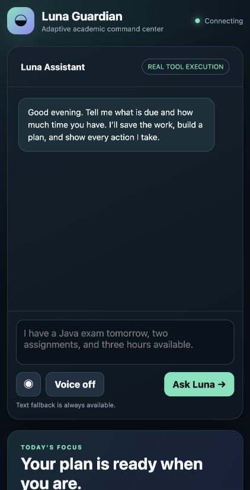

# Luna Guardian AI

Luna Guardian is a voice-first academic planning agent for university students. It turns natural-language commitments into persistent tasks and realistic study sessions, then replans when life interrupts the schedule.

This repository is an **Alexa+-style simulated experience** for the Build, Ship, Shape: Amazon Developer Hackathon 2026. It is not an official Alexa+ integration.



## What is working

- An authenticated MCP server using the official Python SDK, Streamable HTTP, and protocol `2025-11-25`
- Nine persistent tools: `create_task`, `list_tasks`, `update_task`, `complete_task`, `create_study_plan`, `get_study_plan`, `replan_missed_session`, `get_student_context`, and `update_student_context`
- User-isolated relational data for context, commitments, tasks, plans, study sessions, completion history, and agent activity (SQLite locally; PostgreSQL on Render)
- A tool-calling agent with Amazon Bedrock, OpenAI-compatible, and clearly labelled offline rule-based providers
- A responsive dashboard with live priorities, deadlines, schedule, progress, tool activity, browser speech recognition, text fallback, and optional speech output
- Bearer authentication, bounded request sizes, validation, rate limiting, safe timezone conversion, and database error propagation

## Architecture

```text
Browser voice/text
      │
      ▼
FastAPI /api/agent ──► provider (Bedrock / OpenAI-compatible / local rules)
                                     │ model-selected tools
                                     ▼
official MCP client ── authenticated Streamable HTTP /mcp/
                                     │
                                     ▼
                              domain service ──► SQLite / PostgreSQL
```

Production routes model-selected state changes through the MCP boundary; direct execution remains available for local development. The REST dashboard reads the same persisted domain state. The activity timeline is derived from execution records and grouped by the agent request ID; it is not fabricated UI state.

## Local setup

Requires Python 3.11 or newer.

```bash
python3 -m venv .venv
source .venv/bin/activate
pip install -r requirements-dev.txt
cp .env.example .env
uvicorn app.main:app --reload
```

Open <http://127.0.0.1:8000>. The development fallback bearer token is `demo-token`. Production refuses to start without `LUNA_AUTH_TOKENS` or `LUNA_AUTH_TOKEN`.

### Configuration

| Variable | Purpose |
|---|---|
| `LUNA_ENV` | `development` or `production` |
| `LUNA_AUTH_TOKENS` | JSON object mapping opaque bearer tokens to stable user IDs |
| `LUNA_AUTH_TOKEN` | Alternative single opaque token; generated automatically by the Render Blueprint |
| `LUNA_AUTH_USER_ID` | User identity associated with `LUNA_AUTH_TOKEN` |
| `LUNA_DB_PATH` | SQLite database path; use persistent storage in production |
| `DATABASE_URL` | PostgreSQL connection URL; takes precedence over `LUNA_DB_PATH` |
| `LUNA_PUBLIC_HOST` | Optional public hostname override for MCP DNS-rebinding protection; Render injects its hostname automatically |
| `LUNA_RATE_LIMIT_PER_MINUTE` | Per-token request limit, default `120` |
| `LUNA_AGENT_PROVIDER` | `local`, `bedrock`, or `openai-compatible` |
| `LUNA_AGENT_TOOL_TRANSPORT` | `mcp` routes agent-selected actions through the authenticated MCP endpoint; `direct` is the local-development fallback |
| `LUNA_MCP_URL` | Optional MCP endpoint override; production defaults to the local authenticated Streamable HTTP endpoint |
| `AWS_REGION` | Bedrock region |
| `LUNA_BEDROCK_MODEL` | Bedrock Converse model ID |
| `LUNA_OPENAI_BASE_URL` | OpenAI-compatible `/v1` base URL |
| `LUNA_OPENAI_MODEL` | Chat-completions model name |
| `LUNA_OPENAI_API_KEY` | Provider key; never commit this value |

The `local` provider is deterministic and useful for an offline demo, but it is not presented as an LLM. Use `bedrock` or `openai-compatible` for the LLM-powered submission demo.

### Amazon Bedrock

```bash
pip install -r requirements-aws.txt
export LUNA_AGENT_PROVIDER=bedrock
export AWS_REGION=us-east-1
export LUNA_BEDROCK_MODEL=amazon.nova-lite-v1:0
uvicorn app.main:app
```

The current development machine had no AWS CLI or visible AWS credentials, so Bedrock has not been live-verified and AWS Builder eligibility is not claimed.

## MCP protocol

Endpoint: `http://127.0.0.1:8000/mcp/`

Every request requires `Authorization: Bearer <token>`. The verified SDK negotiated MCP `2025-11-25`. A genuine official MCP client completed initialization, `tools/list`, `tools/call create_task`, and `tools/call list_tasks` against the running server.

Example client:

```python
import asyncio, httpx
from mcp import ClientSession
from mcp.client.streamable_http import streamable_http_client

async def main():
    async with httpx.AsyncClient(headers={"Authorization": "Bearer demo-token"}) as http:
        async with streamable_http_client("http://127.0.0.1:8000/mcp/", http_client=http) as (read, write, _):
            async with ClientSession(read, write) as session:
                print((await session.initialize()).protocolVersion)
                print([tool.name for tool in (await session.list_tools()).tools])

asyncio.run(main())
```

REST API documentation is available at `/docs`; the machine-readable OpenAPI contract is `/openapi.json`.

## Verification

```bash
pytest -q
ruff check app tests
python -m compileall -q app tests
```

Verified locally on October 22, 2026:

- 11 automated tests passed
- Ruff passed
- Python compilation passed
- Real MCP initialization negotiated `2025-11-25`
- All nine required tools were discovered
- Authenticated MCP `create_task` and `list_tasks` calls succeeded and persisted data
- The exact Java-exam request completed locally through `/api/agent` → authenticated MCP → persistence with one shared request ID; the equivalent live LLM run remains required before submission

GitHub Actions workflows are present in both repositories, but the initial hosted job was rejected before executing any step because the GitHub account was locked for a billing issue. See the friction log; this is not reported as a test failure or a passing CI run.

Browser speech recognition depends on browser support and microphone permission. Chromium-based browsers generally expose the Web Speech API; unsupported or denied cases retain full text input. This is not Alexa voice transport.

## Deployment

The included `Dockerfile` and `render.yaml` run the application on Render's free web-service and PostgreSQL plans. Before deployment:

1. Let the Blueprint generate `LUNA_AUTH_TOKEN`, or provide `LUNA_AUTH_TOKENS` through Render's secret controls.
2. The Blueprint injects the free Postgres connection string as `DATABASE_URL`; no persistent disk is required.
3. Configure an LLM provider and its credentials.
4. Verify `/health`, load the dashboard, repeat the official MCP client check against HTTPS, and confirm data survives a redeploy.

Render's free web service sleeps after 15 minutes without inbound traffic. Its free PostgreSQL database is limited to 1 GB, has no backups, and expires 30 days after creation; this is suitable for a hackathon demo, not durable production storage.

### Verified public deployment

- App: <https://luna-guardian-ai.onrender.com>
- MCP endpoint: <https://luna-guardian-ai.onrender.com/mcp/>
- Source: <https://github.com/anushkasenmehar1208-hub/luna-guardian-ai>

Verified on October 22, 2026: the public health check and authenticated REST API returned successfully; an official MCP client negotiated protocol `2025-11-25`, discovered all nine tools, and executed `create_task` and `list_tasks`; data created before a web-service redeploy remained in PostgreSQL afterward.

## Project materials

- [Demo script](docs/demo-script.md)
- [Devpost project story](docs/devpost-story.md)
- [Amazon developer product feedback](docs/amazon-feedback.md)
- [Complete product feedback draft](docs/product-feedback.md)
- [Development friction log](docs/friction-log.md)
- [Official submission audit](docs/submission-audit.md)
- [Security notes](SECURITY.md)

## License

MIT — see [LICENSE](LICENSE).
